# Guia das telas

O sistema tem um **menu fixo à esquerda** com as 7 telas. Ao clicar num item, a área da direita é trocada
(função `Aplicativo.ir` em `main.py`). Todas as telas leem e gravam no banco `banco/nfe_importador.db`.

Os dados dos prints são os XMLs fictícios da pasta `xmls_exemplo/`.

---

## 1. Painel (`main.py`, função `painel`)

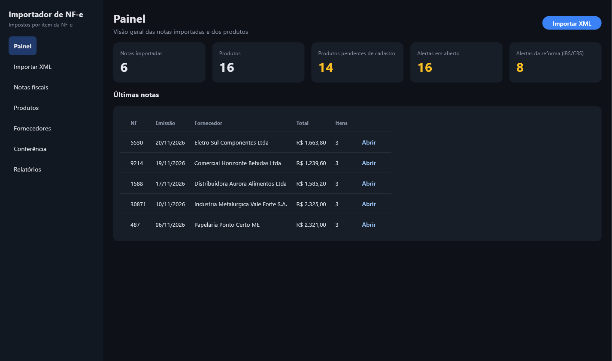

É a tela inicial: um resumo do que já foi importado.

- **Indicadores:** cada cartão é uma contagem (`SELECT COUNT(*)`) no banco: notas importadas, produtos,
  produtos ainda pendentes de cadastro, alertas em aberto e quantos desses alertas são da reforma
  tributária. Os números em amarelo indicam que há algo para resolver.
- **Últimas notas:** as 5 notas mais recentes com fornecedor, total e número de itens. "Abrir" leva
  direto ao detalhe da nota.
- **Importar XML** (canto superior direito) é um atalho para a tela 2.

---

## 2. Importar XML (`importar.py`)

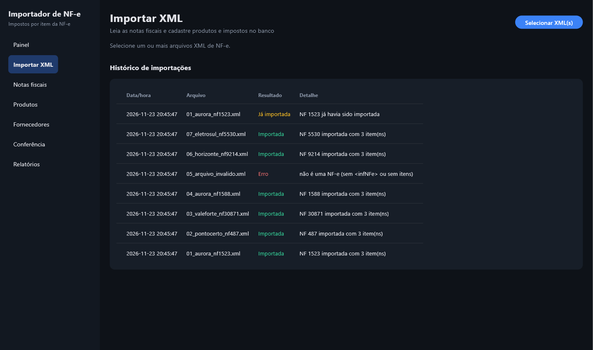

É aqui que os dados entram no sistema.

- **Selecionar XML(s)** abre a janela do Windows para escolher um ou vários arquivos de NF-e.
- Para cada arquivo, o sistema:
  1. lê o XML e separa o cabeçalho (emitente, número, data) e os itens com todos os impostos;
  2. confere cada item e gera os alertas (regras de `conferencia.py` e `reforma.py`);
  3. grava tudo **numa única transação**: fornecedor, nota, produtos, itens, impostos e alertas. Se
     algo der errado, nada fica gravado pela metade.
- **Histórico de importações:** cada tentativa fica registrada com um de três resultados:
  - **Importada** (verde);
  - **Já importada** (amarelo): a chave de acesso da nota já existe no banco, então ela não é duplicada;
  - **Erro** (vermelho): o arquivo não é uma NF-e válida.

---

## 3. Notas fiscais (`notas.py`)

### Lista

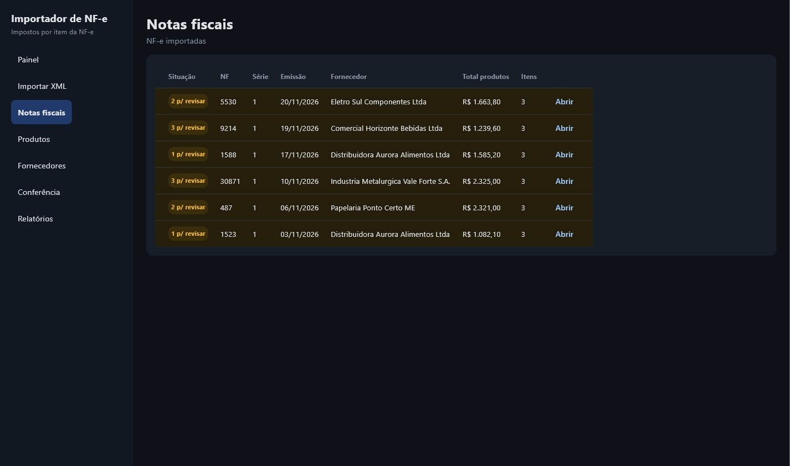

Todas as notas importadas. A coluna **Situação** mostra quantos itens da nota têm alertas em aberto
("2 p/ revisar") ou "OK". As linhas com problema ficam com fundo amarelado. "Abrir" mostra o detalhe.

### Detalhe da nota

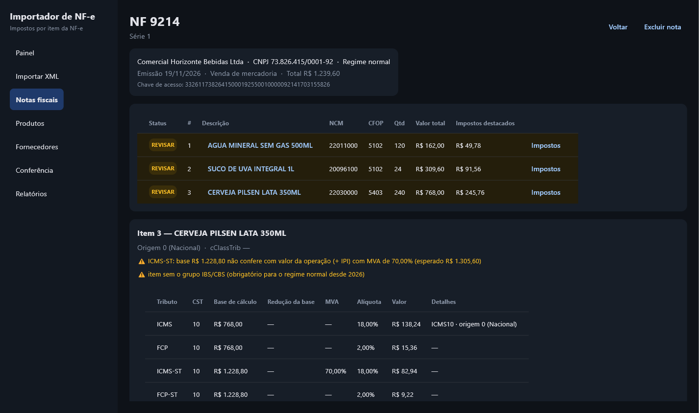

- **Cartão de cima:** emitente, CNPJ, regime tributário, data, natureza da operação, total e chave de acesso.
- **Tabela de itens:** cada produto da nota com NCM, CFOP, quantidade, valor e o total de impostos
  destacados. O selo **REVISAR** indica que o item tem alerta. Clicar na descrição abre a ficha do produto.
- **Quadro de impostos:** ao clicar em **Impostos** num item, aparecem embaixo:
  - os **alertas** do item (em amarelo). No print, a base do ICMS-ST da cerveja não confere com a
    MVA de 70%, e a nota veio sem IBS/CBS;
  - a **tabela de impostos**: ICMS, FCP, ICMS-ST (com a MVA), FCP-ST, PIS, COFINS, IBS e CBS, com
    CST, base de cálculo, redução, alíquota e valor.
- **Excluir nota** pede confirmação e apaga a nota com os itens, impostos e alertas dela (exclusão em
  cascata no banco).

---

## 4. Produtos (`produtos.py`)

### Lista

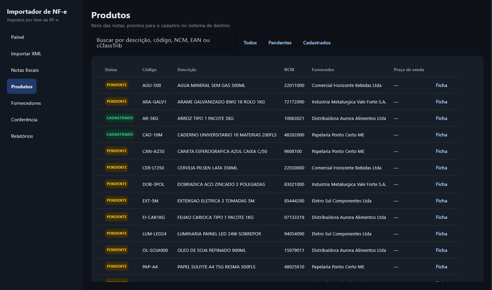

Cada produto que apareceu nas notas vira um cadastro, uma vez por fornecedor e código. A ideia é
levar esses dados para o sistema da empresa.

- **Busca:** por descrição, código, NCM, EAN ou cClassTrib (filtra enquanto você digita).
- **Filtros:** Todos, **Pendentes** (ainda não cadastrados no outro sistema) ou **Cadastrados**.
- **Preço de venda:** aparece depois que o preço é salvo na ficha.

### Ficha do produto: aba Cadastro

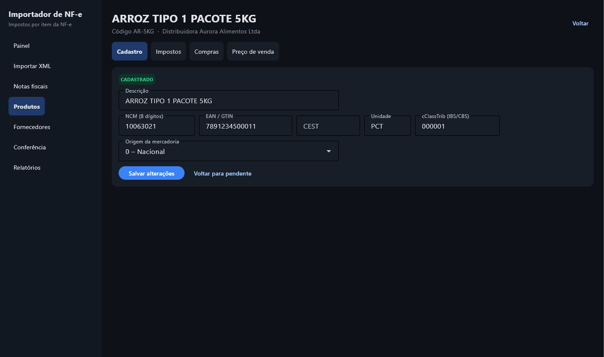

Os dados que o usuário leva para o sistema dele: descrição, NCM, EAN, CEST, unidade, **cClassTrib**
(o código da reforma) e **origem da mercadoria**. Tudo pode ser corrigido e salvo. O botão "Marcar como
cadastrado" muda o status do produto. Assim a lista mostra o que ainda falta cadastrar.

### Ficha do produto: aba Impostos

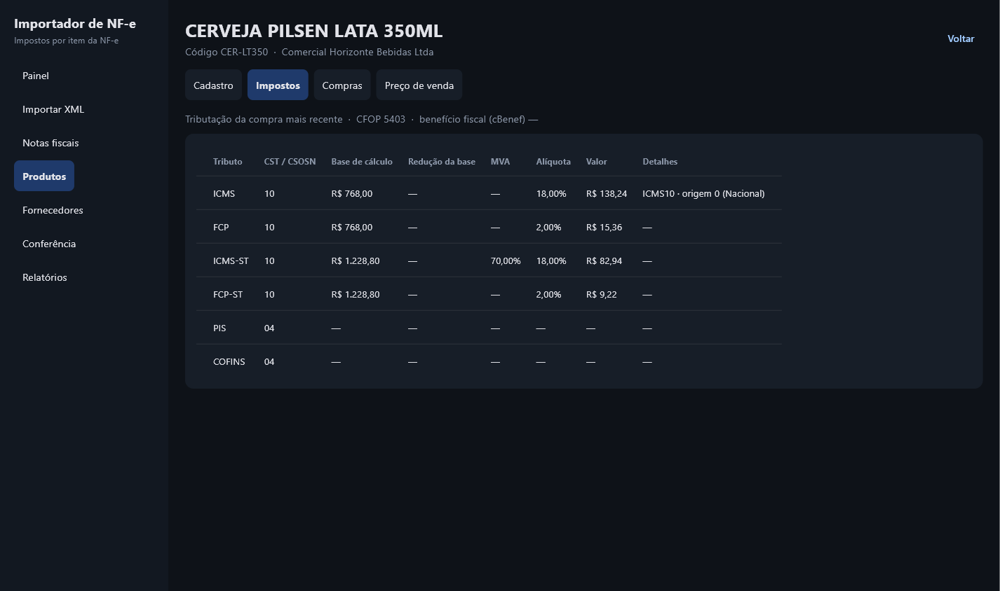

A tributação da **compra mais recente** do produto: cada imposto com CST, base de cálculo, redução,
**MVA**, alíquota e valor. É a informação para configurar a tributação do produto no outro sistema.
No print, a cerveja tem ICMS-ST com MVA de 70% e FCP, e PIS/COFINS com CST 04 (monofásico).

### Ficha do produto: aba Compras

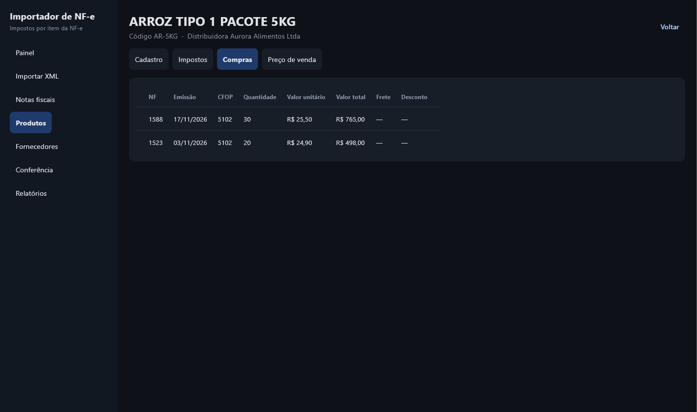

O histórico de compras do produto, da mais recente para a mais antiga: nota, data, CFOP, quantidade,
preço unitário, total, frete e desconto. No print, o arroz subiu de R$ 24,90 para R$ 25,50.

### Ficha do produto: aba Preço de venda

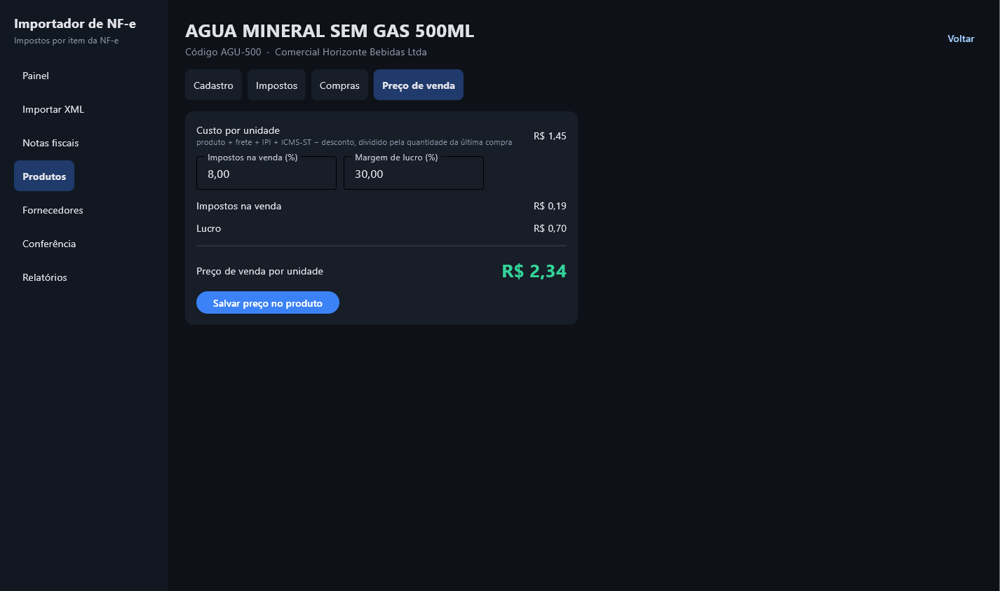

Sugere o preço de venda para ter lucro:

1. **Custo por unidade:** o que cada unidade custou na última compra (produto + frete + IPI + ICMS-ST −
   desconto, dividido pela quantidade). Água: R$ 174,00 ÷ 120 = **R$ 1,45**.
2. **Impostos na venda (%)** e **Margem de lucro (%)**: o usuário digita, e o preço muda na hora.
3. **Preço** = custo ÷ (1 − (impostos + margem) ÷ 100) → R$ 1,45 ÷ 0,62 = **R$ 2,34**. Desse valor,
   R$ 0,19 são impostos e R$ 0,70 é lucro.

"Salvar preço no produto" grava o preço, e ele passa a aparecer na lista de produtos.

---

## 5. Fornecedores (`fornecedores.py`)

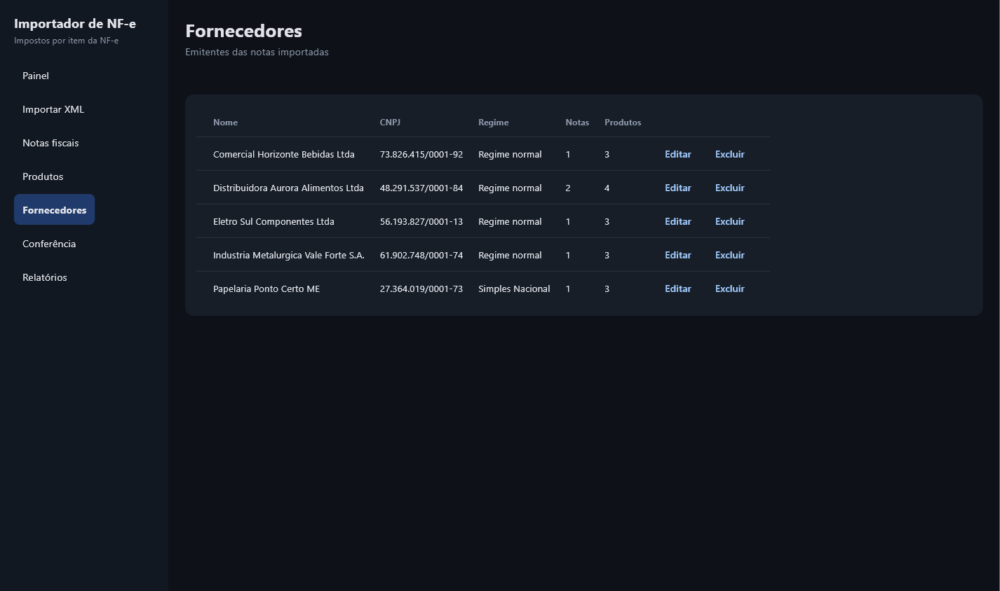

Os emitentes das notas, criados automaticamente na importação a partir do CNPJ. Mostra o **regime
tributário** (lido do XML), quantas notas e quantos produtos cada um tem.

- **Editar:** permite corrigir o nome.
- **Excluir:** só funciona para fornecedor **sem** notas nem produtos. Se tiver, o próprio banco
  recusa por causa da chave estrangeira, e a tela mostra o aviso. Isso demonstra a integridade
  referencial.

---

## 6. Conferência (`alertas.py`)

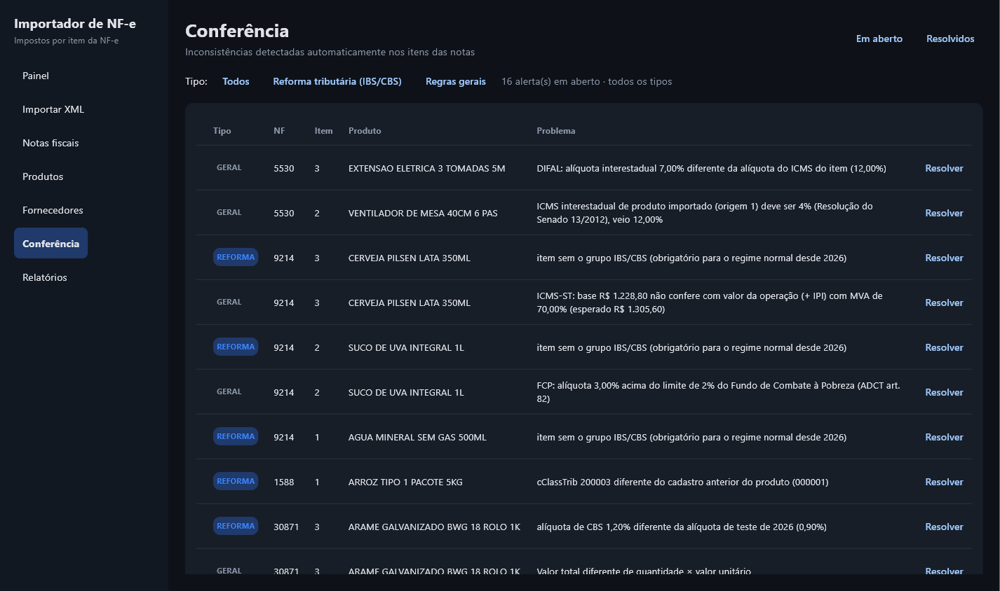

Todos os problemas encontrados na importação, numa lista só:

- **Tipo:** **REFORMA** (regras do IBS/CBS, em `reforma.py`) ou **GERAL** (ICMS, ST, FCP, DIFAL, NCM...,
  em `conferencia.py`). Os botões de cima filtram por tipo.
- **Exemplos do print:**
  - DIFAL com alíquota interestadual de 7% num item com ICMS de 12%;
  - ventilador importado com ICMS de 12% em vez de 4%;
  - nota de empresa do regime normal sem o grupo IBS/CBS;
  - FCP de 3%, acima do limite de 2%.
- **Resolver:** depois que o usuário confere o problema, marca como resolvido. O alerta sai da lista
  "Em aberto" e vai para "Resolvidos", onde pode ser reaberto. "Ver nota" abre a nota do alerta.

---

## 7. Relatórios (`relatorios.py`)

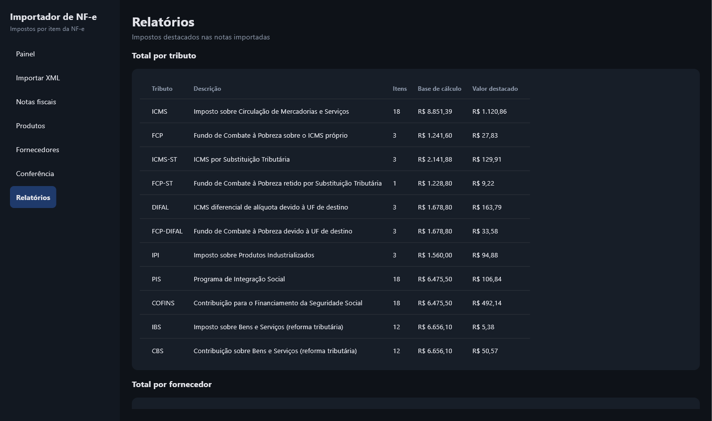

Somas feitas com `JOIN` e `GROUP BY` no banco:

- **Total por tributo:** para cada imposto, em quantos itens apareceu, a soma das bases de cálculo e a
  soma dos valores. Mostra, por exemplo, quanto de ICMS-ST e de DIFAL veio nas notas.
- **Total por fornecedor** (mais abaixo na tela): notas, itens, valor das mercadorias e total de
  impostos de cada fornecedor.
